<picture><source media="(prefers-color-scheme: dark)" srcset="./assets/modern-profile-dark.svg"></picture>

<!-- contribution-calendar:start -->
<picture><source media="(prefers-color-scheme: dark)" srcset="./assets/live-contributions-dark.svg"></picture>
<!-- contribution-calendar:end -->

Desenvolvedor brasileiro. Transformo ideias em experiências web claras e funcionais, com espaço para experimentar, aprender e cuidar dos detalhes.

<a href="https://portfolio-tau-steel-80.vercel.app"><picture><source media="(prefers-color-scheme: dark)" srcset="./assets/live-button-portfolio-dark.svg"></picture></a> <a href="https://www.linkedin.com/in/vinicius-butrico-de-freitas-82912a240"><picture><source media="(prefers-color-scheme: dark)" srcset="./assets/live-button-linkedin-dark.svg"></picture></a> <a href="mailto:butrico0@gmail.com"><picture><source media="(prefers-color-scheme: dark)" srcset="./assets/live-button-email-dark.svg"></picture></a>

<picture><source media="(prefers-color-scheme: dark)" srcset="./assets/live-stack-dark.svg">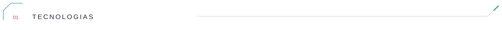</picture>

<picture><source media="(prefers-color-scheme: dark)" srcset="./assets/live-tech-javascript-dark.svg"></picture> <picture><source media="(prefers-color-scheme: dark)" srcset="./assets/live-tech-react-dark.svg">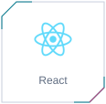</picture> <picture><source media="(prefers-color-scheme: dark)" srcset="./assets/live-tech-vuejs-dark.svg">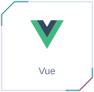</picture> <picture><source media="(prefers-color-scheme: dark)" srcset="./assets/live-tech-java-dark.svg">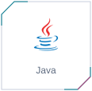</picture> <picture><source media="(prefers-color-scheme: dark)" srcset="./assets/live-tech-cplusplus-dark.svg">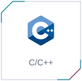</picture> <picture><source media="(prefers-color-scheme: dark)" srcset="./assets/live-tech-git-dark.svg">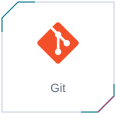</picture>

<picture><source media="(prefers-color-scheme: dark)" srcset="./assets/live-work-dark.svg">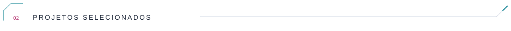</picture>

<a href="https://portfolio-tau-steel-80.vercel.app"><picture><source media="(prefers-color-scheme: dark)" srcset="./assets/live-card-portfolio-dark.svg">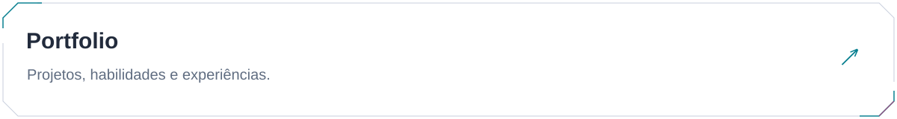</picture></a>

<a href="https://github.com/butrico31/portfolio">Código-fonte ↗</a>

<a href="https://github.com/butrico31/cp2077-archive-xl"><picture><source media="(prefers-color-scheme: dark)" srcset="./assets/live-card-archive-dark.svg">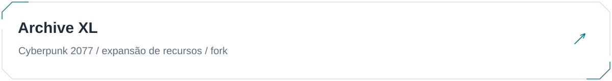</picture></a>

<a href="https://github.com/butrico31/cp2077-archive-xl">Código-fonte ↗</a>

<a href="https://github.com/butrico31/cp2077-tweak-xl"><picture><source media="(prefers-color-scheme: dark)" srcset="./assets/live-card-tweak-dark.svg">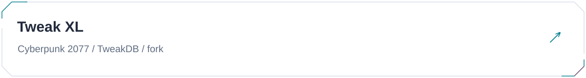</picture></a>

<a href="https://github.com/butrico31/cp2077-tweak-xl">Código-fonte ↗</a>

<picture><source media="(prefers-color-scheme: dark)" srcset="./assets/live-activity-dark.svg">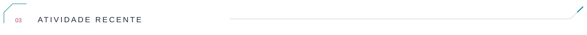</picture>

**68 commits públicos em 2026 · 28 repositórios públicos · 0 estrelas nos repositórios próprios · 5 seguidores**

| Data (UTC) | Atividade pública | Repositório |
| :--- | :--- | :--- |
| 2026-10-26 | Criação de referência | [butrico31/SoftieClub](https://github.com/butrico31/SoftieClub) |
| 2026-10-23 | Criação de referência | [butrico31/mod_settings](https://github.com/butrico31/mod_settings) |
| 2026-10-23 | Commits enviados | [butrico31/RED4ext.SDK](https://github.com/butrico31/RED4ext.SDK) |
| 2026-10-23 | Commits enviados | [butrico31/cp2077-archive-xl](https://github.com/butrico31/cp2077-archive-xl) |
| 2026-10-23 | Criação de referência | [butrico31/cp2077-codeware](https://github.com/butrico31/cp2077-codeware) |

Atualizado em 2026-11-11 09:27 UTC. Commits públicos indexados pelo GitHub Search desde 1º de janeiro; não inclui atividade privada. A lista de eventos é uma janela recente, não o histórico completo.

<picture><source media="(prefers-color-scheme: dark)" srcset="./assets/live-contact-dark.svg">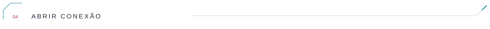</picture>

<a href="mailto:butrico0@gmail.com"><picture><source media="(prefers-color-scheme: dark)" srcset="./assets/live-button-email-dark.svg"></picture></a>

[Todos os repositórios ↗](https://github.com/butrico31?tab=repositories) · [GitHub](https://github.com/butrico31)
